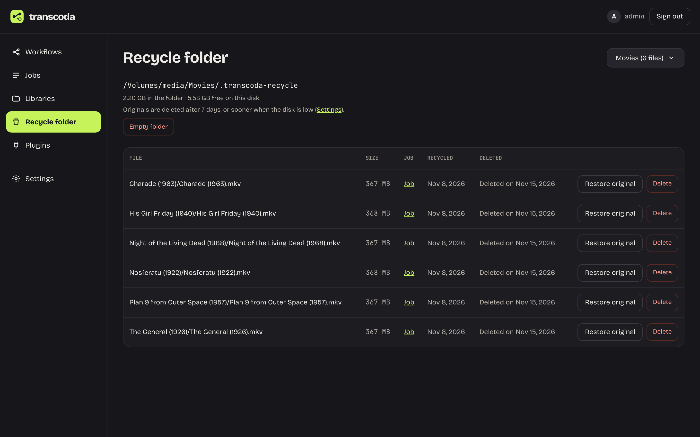
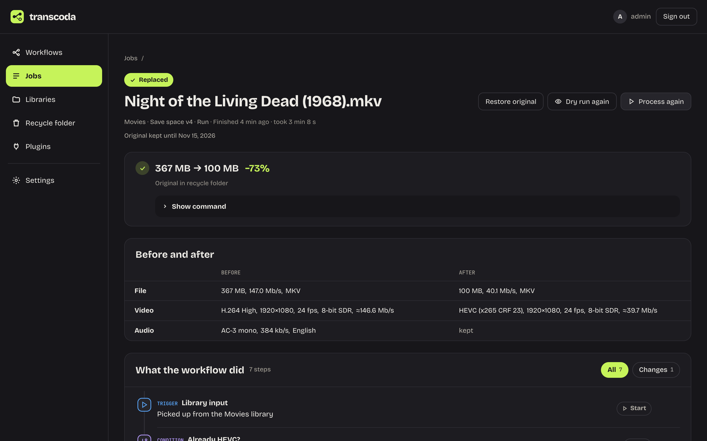

#### Get your original back

Transcoda has always kept the original in the library's recycle folder before it replaces a file. Now you can use it without leaving Transcoda.

The new **Recycle folder** page in the main menu shows what each library's recycle folder holds and when each file will be deleted. A file can go sooner if the recycle folder takes up more than its share of the disk, which can also happen when other files fill the disk up; the oldest originals are deleted first. From there you can restore an original, put Transcoda's version back if you change your mind, delete one file or empty the folder.

On a replaced file's job page, **Restore original** does the same for that one file. The workflow that converted it leaves the restored file alone from then on, so the next scan won't convert it again unless you ask with **Process again**.

#### Run a workflow again, on purpose

Scan now skips files that an older version of the same workflow already processed, as long as they haven't changed since (a file copied to another disk counts as new), so activating a new version no longer runs it over your whole library again. When you do want that, scan the library and use **Process again** on that scan's run page: it queues the files the scan skipped as already processed in one go.
