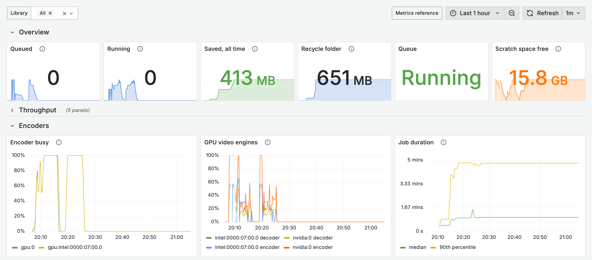
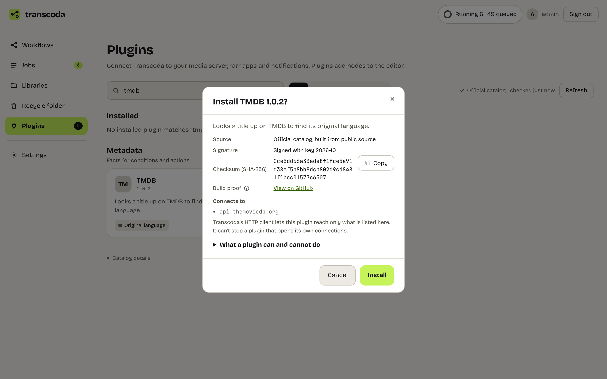

#### Chart Transcoda in Grafana

Transcoda now serves Prometheus metrics: the queue, jobs by state and outcome, space saved per library, hours of video encoded, encoder and GPU load, and the recycle folder's size. Point Prometheus at `/metrics` with an API token that has only the new `metrics` scope, then import the ready-made dashboard from `examples/grafana`. The metrics guide in `docs/metrics.md` walks through both, plus a Home Assistant sensor that reads a short status summary.

#### See where a plugin connects before you install it

The install dialog now lists the hosts a plugin connects to, such as api.themoviedb.org, or the server address you enter in its settings for Sonarr, Radarr and the other media apps. Transcoda's HTTP client lets a plugin reach only what is listed there. An update that would connect to a new host asks first and marks that host as new.

