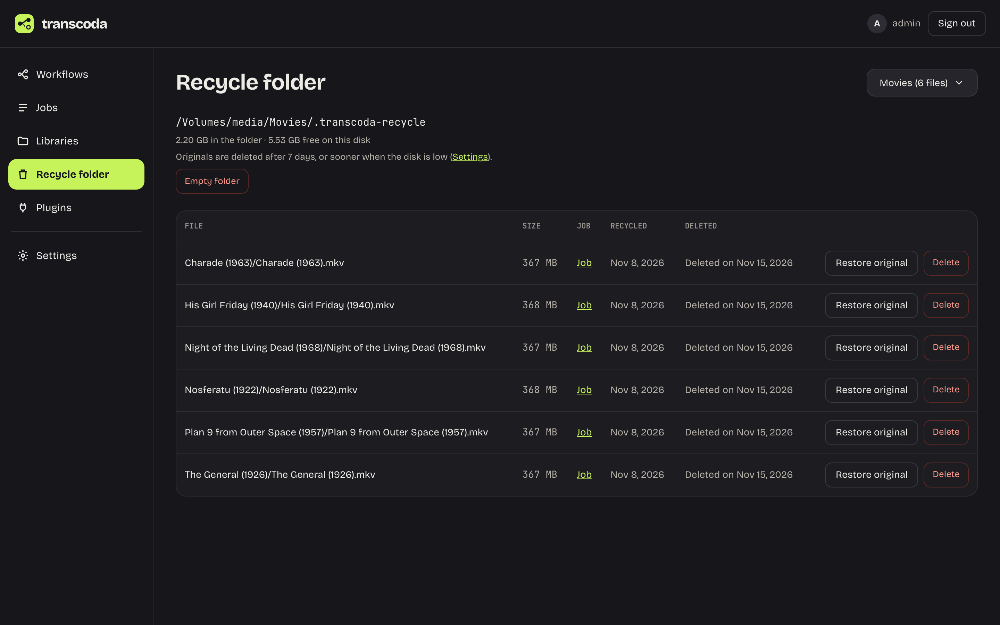
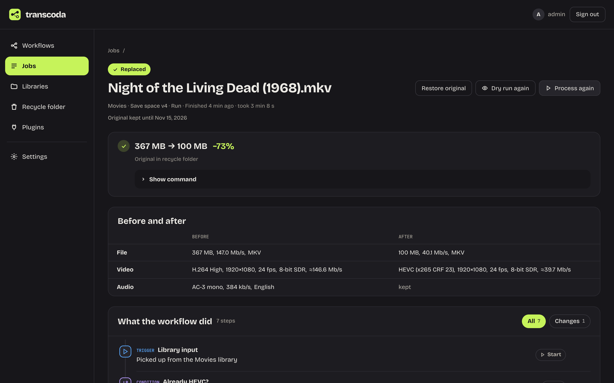

# Changelog

All notable changes to Transcoda, newest first. Generated from the notes in `.changes/` when a release is cut.

## 0.4.0 — 2026-11-10

#### Get your original back

Transcoda has always kept the original in the library's recycle folder before it replaces a file. Now you can use it without leaving Transcoda.

The new **Recycle folder** page in the main menu shows what each library's recycle folder holds and when each file will be deleted. A file can go sooner if the recycle folder takes up more than its share of the disk, which can also happen when other files fill the disk up; the oldest originals are deleted first. From there you can restore an original, put Transcoda's version back if you change your mind, delete one file or empty the folder.

On a replaced file's job page, **Restore original** does the same for that one file. The workflow that converted it leaves the restored file alone from then on, so the next scan won't convert it again unless you ask with **Process again**.

#### Run a workflow again, on purpose

Scan now skips files that an older version of the same workflow already processed, as long as they haven't changed since (a file copied to another disk counts as new), so activating a new version no longer runs it over your whole library again. When you do want that, scan the library and use **Process again** on that scan's run page: it queues the files the scan skipped as already processed in one go.

### New

- A run's page now has Process again, which queues the run's Already processed files once more in one go, and an Already processed file's note now points to Process again. On a job whose workflow has no active version, the job page offers only Dry run again.
- A new Recycle folder page in the main menu shows what each library's recycle folder holds and when it will be deleted. From there you can restore an original, put Transcoda's version back after a restore, delete one file, or empty the folder.
- A replaced file's job page has Restore original, which puts the original back from the recycle folder and moves Transcoda's version there instead. Transcoda leaves a restored file alone until you use Process again.

### Improved

- Settings → About links the Transcoda version to its release notes on GitHub. A development build links to the commit it was built from.
- A build that isn't a release, such as the `main` image, now shows its version as `0.3.0-dev`, and the published images add the commit they were built from (for example `0.3.0-dev+16ce86f`), so it is no longer mistaken for the release.
- The Jobs page lists each lane on its own line, with long file names cut short, and a job that is encoding now shows a turning icon, while a planned job waiting for its turn shows an hourglass.
- The workflow editor is easier to read: settings show plain option names and their defaults the same way for every node, a node you add is selected right away, and a past version you can't activate no longer offers to.
- Bitrates read the same everywhere on the job page, such as "3.3 Mb/s" or "160 kb/s". Before and after shows frame rate and HDR on both sides and leaves out bitrates it doesn't know instead of showing a dash. Dry runs say what a real run would write, and finished jobs say what they wrote, in the steps and on the flow.
- The Jobs list can show only real runs or only dry runs, its lanes read "Encoder" and "Quick tasks", and a job's own Pause is hidden while the whole queue is paused. The run page keeps a steady set of tiles, its summary counts every file, and rows no longer repeat the outcome, sizes or the Dry run badge.
- On the Libraries page, the workflow that feeds a library now opens with a click, Scan now names the library's run hours, and the "already finished" option reads the same in Scan now and Dry run. Dialog titles have a divider so scrolled content no longer slides under them, and on a phone a job's workflow drawing starts closed below its steps.
- The plugin install dialog now says what a plugin does and shows its full checksum with a Copy button, and a plugin that fails to start says so plainly. In Settings, the Open-source licences page has a way back to About, and an API token's expiry date is spelled out.
- The Workflows list now has a Trigger column that shows what starts each workflow: a library (by name), a webhook, or a file you pick by hand.
- Scan now no longer queues files that an older version of the same workflow already processed, for example after you activate a new version. Use Process again to run such a file anyway. It also skips a file that another run is still processing, so two jobs never work on the same file at once.
- In Settings, the current section is now marked by a green icon instead of a green bar.

### Fixed

- Check source and verify no longer read a cover image stored as a video track. On such files (for example one an earlier conversion turned from an attachment into a video track) the check could use more and more memory until the server slowed to a crawl. As a safety net, these checks are now stopped if ffmpeg uses more than 4 GiB of memory (or half of the container's memory, if that is less); the job then fails with a reason that says so, and the file is never marked as damaged. The limit can be changed or turned off with `TRANSCODA_DECODE_MEMORY_GIB`.
- The editor's Tidy up and minimap buttons now show their icons instead of a solid block.
- With an Intel GPU, a video its decoder can't read (such as 4:2:2) now still encodes on that GPU instead of falling back to the CPU, and a job no longer waits for a GPU it can't use. The GPU order in Settings now lists only the GPUs that can encode. A custom workflow that sets `-hwaccel qsv` now decodes and encodes on the Intel GPU the job was given.
- A job that goes back to the queue (Retry failed, a restart, or another GPU after a failure) no longer says "Encoding on GPU" while it waits.
- A file that came out bigger than its original is no longer shown as a saving. A kept file now reads "Grew by 18.9% (gate ≥ 15%)" instead of "saved only -18.9%". A day where files grew shows "Grew 104 B" in the Jobs header, without the green colour of a saving. The size gate's reason reads the same on the Jobs list, the run page and the job page.
- A plugin's path mappings fit a phone screen: each mapping is its own block with a labelled field for each side, its buttons on their own row and the Test mapping answer below them. The help line above them now names the two paths in the order of the fields.
- A file Transcoda can't read now fails with a plain reason, such as "The file couldn't be read: it isn't a valid video file", instead of the full ffprobe command and output. The command and output are in the job's log, and a long reason on the Jobs page is cut to two lines.
- A mistyped Settings address now says "Page not found" in the browser tab too, and an unexpected sign-in failure reads "Couldn't sign in. Try again." like the other sign-in messages.
- A run's page now says why its waiting files don't start, in the same words as the Jobs page: "Queue paused" while the queue is paused, and a Paused chip on a job you paused yourself.

## 0.3.0 — 2026-11-02

### New

- The new Already processed step checks whether a file has already been through a workflow, this one or another, in any version or a specific one. It recognises the files Transcoda wrote, even after they replaced the original, and also identical copies of a file, for example one that was moved to another drive or downloaded again. Transcoda writes its files exactly as before; nothing is added to them.
- Transcoda tells you when a new version is out: Settings gets a badge in the menu, and Settings → About shows what the new version brings and the command to update. It checks GitHub every 6 hours and never updates on its own; set `TRANSCODA_UPDATE_CHECK=false` to turn the check off.
- Damaged downloads can now be handled in the workflow. Every workflow gets a Render step; turn on its Quality check and a file whose source turns out to be damaged takes a new Damaged output instead of failing, where Sonarr or Radarr can replace it. The new Check source step reads a file once and sends damaged files the same way before any time is spent encoding.
- The Jobs page has a Cancel all button next to Pause queue. After you confirm, it cancels every queued, running and paused job, in the chosen library or in all of them. Running encodes stop and their partial output is deleted, so their originals stay untouched. Jobs already replacing their file finish.
- Libraries now watch their folder, so a new video is queued as soon as it has finished copying instead of at the next 15-minute check. You can turn this off per library under Advanced. A network share (NFS or SMB) that another machine writes to sends no notice of new files, so those libraries still rely on the 15-minute check.
- Transcoda now checks for plugin updates in the background and shows how many are waiting next to Plugins in the menu. An update that doesn't affect any workflow installs with one click, and the Updates tab has an Update all button.

### Improved

- In the editor, a step with more than one file output, such as Check source with OK and Damaged, now names each output instead of showing "file" twice. The search for adding a step shows a short description under each step and marks the text you typed.
- An encode that stops writing output is now stopped after an hour instead of running on and using more and more memory. If it never wrote anything, the job fails with a reason that explains why; if it stopped partway (for example a network share that hung), the job is tried again, on another GPU or in software when the GPU was encoding. Slow encodes keep writing output and are not affected; the limit can be changed or turned off with `TRANSCODA_ENCODE_STALL_MINUTES`.
- Every Docker image now comes with a signed record of how it was built and a list of its packages, so you can check that it really came from the Transcoda repository: `gh attestation verify oci://ghcr.io/transcoda/transcoda:latest --repo transcoda/transcoda`. Release pages carry both as files too.
- Testing a Radarr or Sonarr connection now warns when one of its root folders isn't inside any of your libraries, and suggests the path mapping to add, so lookups that would fail show up at setup.
- A step can now be reached from several branches: connect more than one line into its file input, for example one Replace damaged file step after both Damaged outputs, instead of adding the step once per branch. Saved workflows that showed an error for a file input with several connections are now valid.
- The Plugins page matches the rest of Transcoda: the same status chips and headings, and empty tabs and a blocked count of 0 are left out.
- Pages look and read more alike: one chip style where "Kept original" and other no-change outcomes are a quiet grey outline, one heading style, plain stat tiles, and dates like "8 min ago" or "Oct 25". The Jobs page fits the list above the fold, with the 7-day charts and the encoder's last hour side by side and the queue controls in the header; every row opens its job with one click. A run's page leads with what it saved and lists its files without the extra columns, as cards on a phone. The job page shows the result right under the header: what changed, or why the file failed or was left alone, in plain words, with the raw command and log one click away. Empty sections are gone. The workflow editor's top bar is calmer: Save is the one lime button, and Run on a file, Activate and Save with a note live in the ⋯ menu. The version pill says whether that version is active, and the right panel shows only the issues list until you select a node. New workflow shows the chosen kind with a lime outline and puts Create on the right. Libraries keep the path on one line, show recycle and hardlink settings only when changed, and show each library's workflow with the same Active pill as the Workflows page. Settings show one heading and only the values you've changed, with server-set values tucked away. Sign in names the server once.
- The Workflows list is easier to scan: active workflows come first, each row shows which library it processes, and a warning appears next to the name only when a workflow has errors, can't run or uses an outdated sub-workflow. A newer version that isn't active yet shows as "v3 not activated", which you can click to activate it.

### Fixed

- A cover image stored as a video track (for example one an earlier conversion turned from an attachment into a one-frame video) is now copied instead of encoded. Encoding it held back the whole output, so a job could run for hours with an empty output file while ffmpeg used more and more memory. Turning off "Keep cover images" now removes all cover images and poster tracks: these image tracks, and also plain JPEG or PNG poster tracks next to the video, which it used to keep.
- Decode errors in a file's DTS audio are now recognised as a damaged source, so the original is kept and the job says why, instead of failing with raw ffmpeg output.
- Libraries now pick up new videos on their own: a minute after Transcoda starts and then every 15 minutes, each library with an active workflow queues the files it hasn't seen yet, so you no longer need to press Scan now. Files still being copied wait for the next check, and files Transcoda already processed or wrote are not queued again. A copy of one at another path counts as a new file; the Already processed step can still recognise it by its content. The first check after updating also queues the files in a library that was never scanned, except files you already ran a dry run on; Scan now queues those.
- A scan no longer queues the files Transcoda itself wrote, where it wrote them. A file a workflow already replaced is now marked Already processed for that workflow version, like the original was, instead of being queued and checked again. Run with force to process it anyway.

## 0.2.1 — 2026-10-29

### Fixed

- After an update, the browser now loads the new version of Transcoda right away instead of sometimes running the previous one from its cache until a hard reload.
- Security fixes in two libraries the server uses to read requests (body-parser and fast-uri).

## 0.2.0 — 2026-10-26

### New

- Transcoda can now encode on Intel Arc and other Intel GPUs with Quick Sync next to NVIDIA ones. Set the order in Settings → Queue: a job goes to the first free GPU, so the second card only works when the first is busy.

## 0.1.0 — 2026-10-25

### New

- The first release of Transcoda: build ffmpeg workflows in a visual editor, try them on one file with a dry run that writes nothing, then let them work through your library. Every result is checked before it replaces an original, and the original goes to a recycle folder.
- Three ready-made examples to start from: Save space, Play everywhere and Keep my languages. Each opens with a note that says what it does and what to change, and shared values let one list of languages feed every node that needs it.
- The Jobs page shows what is running, how much space you have saved, the last 7 days and a live graph of the encoder. Each job's page compares the file before and after and draws the path it took through the workflow.
- NVIDIA, Intel and AMD encoders are found and used automatically, with one CPU retry if a GPU encode fails. Settings → Queue and engine picks the encoding device; with several NVIDIA GPUs each one encodes a job of its own.
- Official plugins for Sonarr, Radarr, Jellyfin, Bazarr, Seerr, TMDB, ntfy and Discord install from the Plugins page. They are signed and each runs in its own sandbox. Plugin authors can install the SDK from npm as `@transcoda/sdk`.
- Scan a library in one click, let the queue run only in the hours you choose, or start a workflow from a webhook. A REST API and an MCP server let scripts and AI assistants check jobs and build workflows; activating a workflow always stays with a person.
- Transcoda has numbered releases. The Docker image is tagged `latest`, `0.1` and `0.1.0`; `main` is the newest unreleased build.
