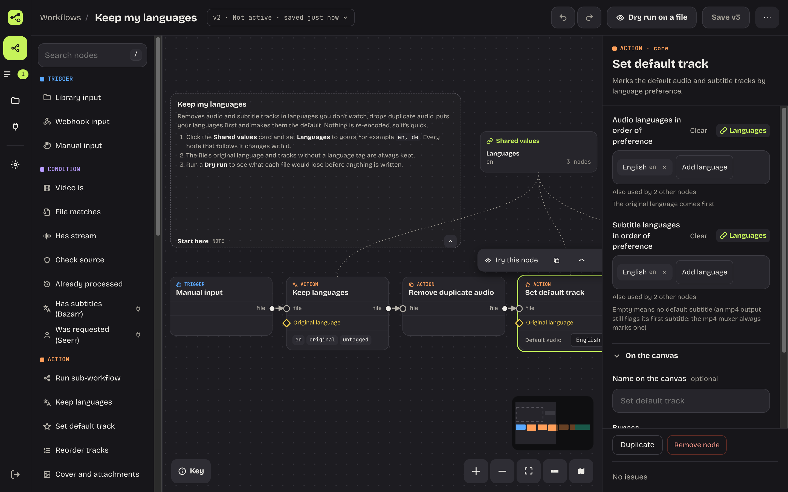
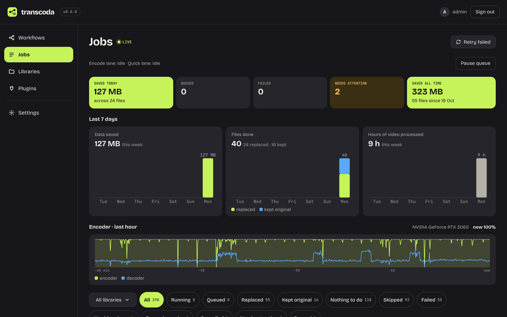
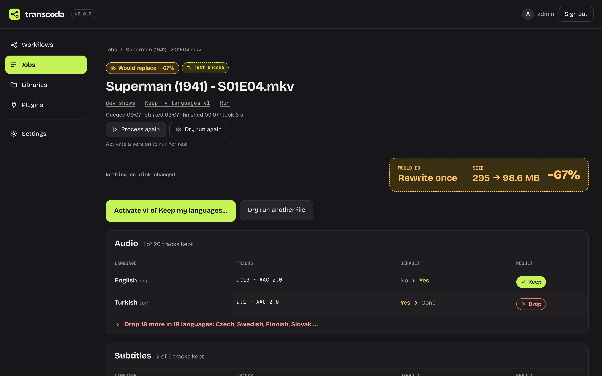
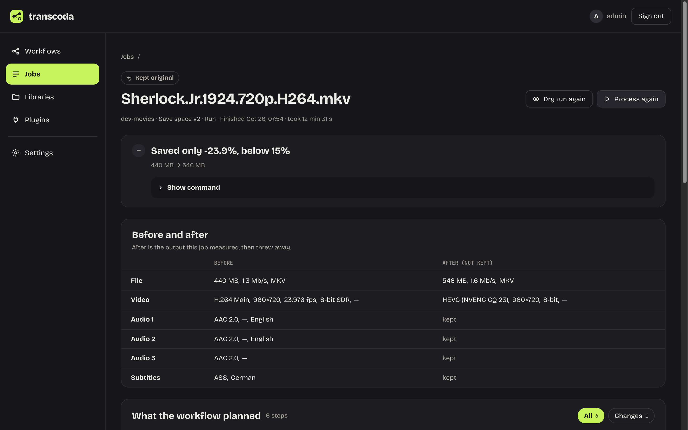
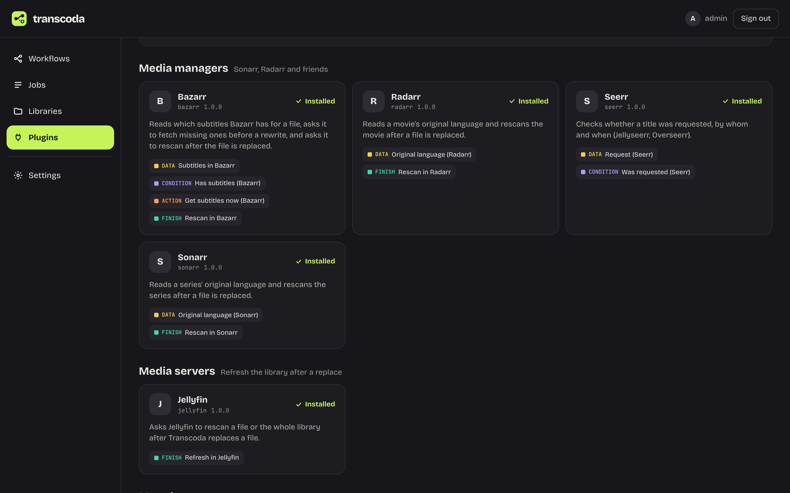

<p align="center">
  
</p>

<h1 align="center">Transcoda</h1>

<p align="center">
  <strong>Clean up your media library with workflows you can see.</strong><br>
  Shrink videos, fix files that won't play, keep only the languages you watch.<br>
  Built on ffmpeg, safe by default, one Docker container.
</p>

<p align="center">
  <a href="https://github.com/transcoda/transcoda/releases/latest"></a>
  <a href="https://github.com/transcoda/transcoda/actions/workflows/ci.yml"></a>
  <a href="https://scorecard.dev/viewer/?uri=github.com/transcoda/transcoda"></a>
  <a href="LICENSE"></a>
</p>



## Why Transcoda

A media library collects mess: files three times bigger than they need to be, audio in five languages you never use, subtitles that won't show, a format your TV refuses to play. Fixing it by hand is a pile of ffmpeg commands. Fixing it with a script means trusting it with every file you own.

Transcoda gives you a visual editor to build the fix once, shows you exactly what it would do to a file before it touches anything, and then works through your library on its own, checking every result before it replaces an original.

## Features

- **Workflows you can see.** Drag nodes onto a canvas and wire them up: conditions ("is it HEVC?", "has a German audio track?", "already been through this workflow?"), actions (encode, keep languages, set default tracks, reorder, remux) and finish steps. Notes on the canvas explain what a workflow does, and shared values let one list of languages feed every node that needs it.
- **Try before anything changes.** A dry run on one file encodes it for real, verifies it and measures the saving, but writes nothing to your library. Play or download the result from the job page. When it looks right, activate that version of the workflow; saving never changes what runs.
- **Safe by default.** Every file is rewritten at most once. The result is checked (duration, streams, a decode test) before it replaces the original, the original goes to a recycle folder, and a crash halfway through never leaves a broken file behind.
- **Uses your GPU.** NVIDIA (NVENC), Intel (Quick Sync, VA-API) and AMD encoders are detected and used automatically, with a software fallback if a hardware encode fails.
- **Watch it work.** The Jobs page shows what's running, how much space you've saved each day and how busy the encoder is. Each job draws the path the file took through the workflow.
- **Works with your stack.** Official plugins for Sonarr, Radarr, Jellyfin, Bazarr, Seerr, TMDB, ntfy and Discord: branch on a show's original language, rescan after a file changes, get a push when a job is done. Plugins are signed and run sandboxed. [More plugins →](https://github.com/transcoda/transcoda-plugins)
- **Automate it.** Scan a library in one click and let the queue run only in the hours you choose, or start a workflow from a webhook. A REST API (`/api/v1`, OpenAPI at `/api/openapi.json`) and an [MCP server](docs/mcp.md) let scripts and AI assistants check jobs and build workflows; activating a workflow always stays with a person.

## Start from an example

New workflows can start from a ready-made example (Workflows → Examples). Each one opens with a note that says what it does and what to change.

| Example | What it does |
| --- | --- |
| **Save space** | Re-encodes video that isn't HEVC yet and keeps the result only if it's at least 15% smaller. |
| **Play everywhere** | Re-encodes only the files your devices can't play, and adds a stereo audio track when needed. |
| **Keep my languages** | Keeps the audio and subtitle languages you list, removes duplicates and sets the defaults. No re-encoding, so it's quick. |

More in [`examples/workflows`](examples/workflows).

## Screenshots

| | |
| --- | --- |
|  |  |
| **Jobs**: progress, savings per day and encoder load. | **Dry run**: see the plan and the result before anything changes. |
|  |  |
| **Job detail**: the path each file took. | **Plugins**: signed, sandboxed integrations. |

## Install

The image bundles the server, the web UI and [jellyfin-ffmpeg](https://github.com/jellyfin/jellyfin-ffmpeg). Everything (UI, RPC, REST API) is served on port 8080.

```yaml
# docker-compose.yml (full example in docker/docker-compose.yml)
services:
  transcoda:
    image: ghcr.io/transcoda/transcoda:latest
    ports:
      - "8080:8080"
    environment:
      PUID: "1000"
      PGID: "1000"
      PLUGIN_UID: "65001"
      PLUGIN_GID: "65001"
    volumes:
      - ./config:/config
      - /mnt/ssd/transcode:/transcode
    security_opt:
      - no-new-privileges:true
    cap_drop:
      - ALL
    cap_add: [CHOWN, DAC_OVERRIDE, FOWNER, FSETID, SETUID, SETGID, SETPCAP, KILL]
    read_only: true
    tmpfs:
      - /tmp:size=64m
      - /run/transcoda:size=256m,mode=0755
    pids_limit: 1024
    mem_limit: 4g   # see docker/docker-compose.yml for how to size it
    restart: unless-stopped
```

Then open `http://<host>:8080` and create the admin account. Add a library for a media folder, pick an example workflow, try it on one file, and activate it when the plan looks right.

Image tags: `latest` (newest release), `0.1` (newest 0.1.x), `0.1.0` (exact), `main` (unreleased builds). See [`docs/releasing.md`](docs/releasing.md).

Every image built by our GitHub Actions carries a signed build provenance and a package list (SBOM). To check that an image really came from this repository, with the [GitHub CLI](https://cli.github.com/):

```sh
gh attestation verify oci://ghcr.io/transcoda/transcoda:latest --repo transcoda/transcoda
```

<details>
<summary>What the compose file sets up, and why</summary>


- `/config` holds the database, its backups and the generated secret key. `/transcode` is the scratch space for transcodes; put it on a fast disk.
- The container starts as root only to create directories and drop privileges: the server runs as `PUID:PGID` with the capabilities `SETUID`, `SETGID` and `KILL`, and every plugin process runs as `PLUGIN_UID:PLUGIN_GID` (default 65001) with none. `/config` and `/transcode` are made unreadable for other users. With `--user` the plugin user is not available; the image then refuses to start unless you opt out of isolation (see `docs/env.md`).
- The container also gives the server the groups of any `/dev/dri/*` or `/dev/mpp_service` devices you pass in. Existing files in `/config` are not re-owned unless `TRANSCODA_CHOWN_CONFIG=1`.
- With `--user uid:gid` (or `user:` in compose) the user switch is skipped; the mounted `/config` and `/transcode` must then be writable by that user.
- Keep the `cap_drop`/`cap_add`, `no-new-privileges`, `read_only` and `tmpfs` lines from the example: they are what the security notes in `docs/plugin-sdk.md` assume. Never run the container privileged, with `seccomp=unconfined`, or with the Docker socket mounted — a plugin that reaches `docker.sock` is root on the host.
- Hardware transcoding: for NVIDIA see the commented block in `docker/docker-compose.yml`. For an Intel GPU (Quick Sync), pass its render node, for example `devices: ["/dev/dri/renderD128:/dev/dri/renderD128"]` (or all of `/dev/dri`); Transcoda finds Intel GPUs by their render node, so `/dev/dri/by-path` is not needed. NVIDIA and Intel GPUs can be used together: set their order in Settings → Queue.
- In a Proxmox LXC container, pass the render node into the container first, with the host's `render` group id: `dev0: /dev/dri/renderD128,gid=993` in `/etc/pve/lxc/<id>.conf` (use the next free `devN`; `getent group render` on the host prints the gid), then restart the container.

Build the image yourself from the repo root: `docker build -f docker/Dockerfile -t transcoda:dev .`

</details>

### Environment variables

The most common ones are `PUID`, `PGID` and `UMASK` (container user; the server also uses `PUID`/`PGID` for the files it replaces), `TZ` (local time zone for run hours and the Jobs page's days; UTC when unset), `TRANSCODA_ALLOWED_HOSTS` and `TRANSCODA_TRUSTED_PROXIES` (reverse proxy), `TRANSCODA_SECRET_KEY`, `TRANSCODA_FFPROBE_PATH` and `TRANSCODA_OUTPUT_ROOTS`. The full list with defaults is in [`docs/env.md`](docs/env.md). Server name, theme, recycle limits and the plugin call timeout are changed in the UI under Settings; environment variables are shown there read-only.

## Documentation

- [Environment variables](docs/env.md) and reverse proxies
- [Plugins: install and set up](docs/plugins.md) · [write your own](docs/plugin-sdk.md)
- [MCP server for AI assistants](docs/mcp.md)
- [Releases and versioning](docs/releasing.md) · [Changelog](CHANGELOG.md)
- [Design decisions](docs/decisions.md)

## Contributing

Bug reports, ideas and pull requests are welcome. Start with [CONTRIBUTING.md](CONTRIBUTING.md); security problems go through [SECURITY.md](SECURITY.md).

## Development

Requirements on a Mac: Node 24 (`>=24.22.1`), pnpm via corepack, and ffmpeg for the capability probe (`brew install ffmpeg`; the Docker image uses jellyfin-ffmpeg instead).

```sh
corepack enable
pnpm install
pnpm --filter @transcoda/server dev   # API on http://localhost:8080, state in apps/server/.local/config
pnpm --filter @transcoda/web dev      # UI on http://localhost:5173, proxies /api and /rpc to :8080
```

Open `http://localhost:5173`; the first visit asks you to create the admin account. `localhost` is always an allowed host.

| Command | Does |
| --- | --- |
| `pnpm check` | typecheck, lint, dependency-direction check, licence check and tests (what CI runs; `pnpm ci` is a pnpm built-in, so the script is named `check`) |
| `pnpm test` / `pnpm typecheck` / `pnpm lint` | one step of the above |
| `pnpm format` | Biome autofix |
| `pnpm build` | production bundles for web and server |
| `pnpm notices` | (not `pnpm licences`: that is a pnpm built-in) writes `apps/server/third-party.json` and `apps/server/THIRD_PARTY_NOTICES.txt` (git-ignored; the Docker build runs it) from the production dependencies of web and server, plus the image's jellyfin-ffmpeg, Node.js and Debian base and the vendored lucide icons |

`pnpm check` (and so CI) fails when a production dependency's licence is outside the allow-list (`ALLOWED` in `scripts/third-party-notices.ts`: permissive licences and OFL-1.1 for the fonts; GPL, LGPL and AGPL fail) or when a package ships no licence text. An exception, a corrected licence or a hand-supplied text goes in `scripts/licences/overrides.json`, keyed by package name (or `name@version`) and always with a `reason`; text files live beside it.

To run the production bundle without Docker: `pnpm build && TRANSCODA_CONFIG_DIR=./.local/prod-config TRANSCODA_WEB_DIR=apps/web/dist node apps/server/dist/main.js`.

## License

Transcoda is free software under the [GNU General Public License v3.0](LICENSE).
